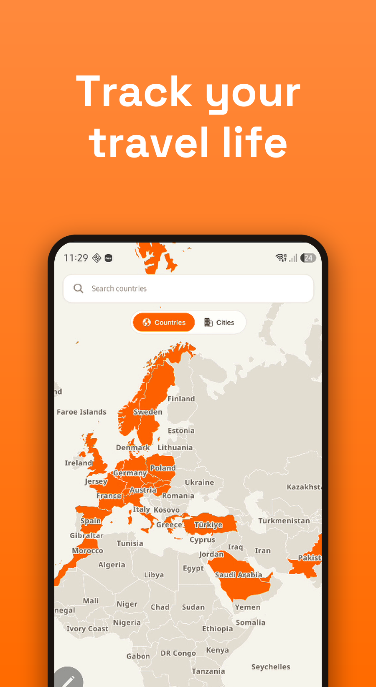
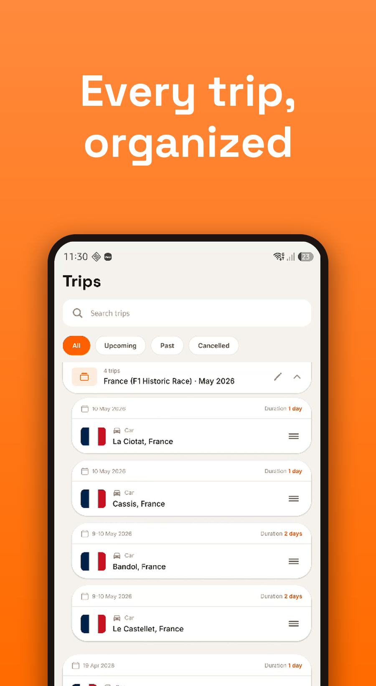
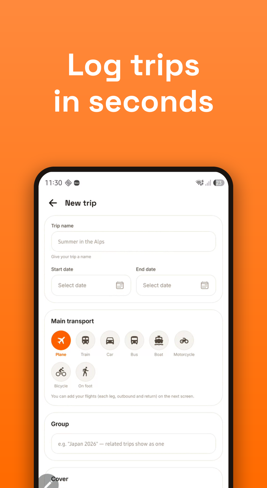
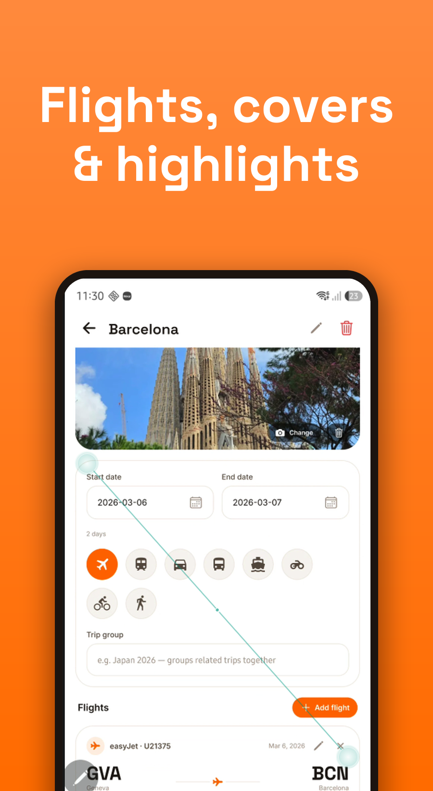
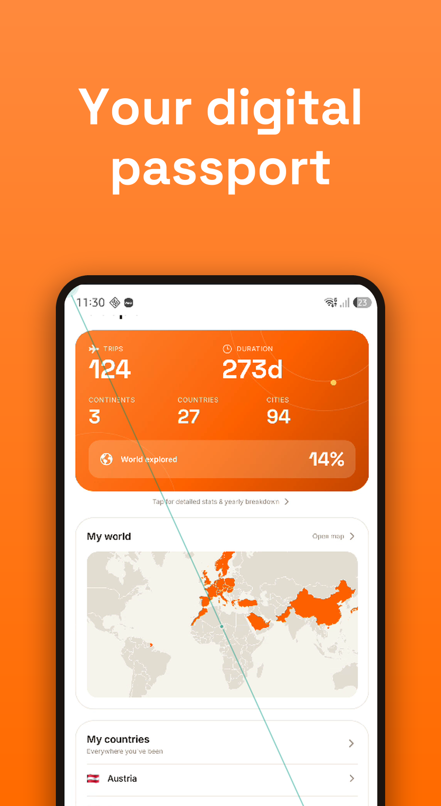
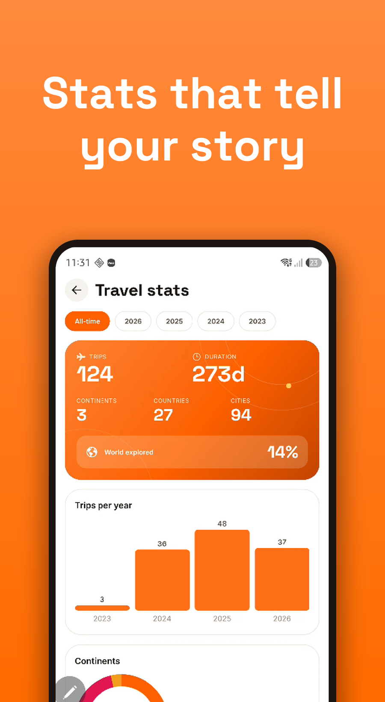

# Odyssey

**Every journey matters.** A premium personal travel companion — your permanent archive of every place you've ever visited.

## Web

Run `npm run web` with your Supabase variables configured in `.env`. The browser app shares Odyssey's travel features and theme with the mobile app. See [web deployment setup](docs/deploy-web.md) for Vercel, Namecheap, and sign-in configuration.

## Showcase

<p align="center">
  
  
  
</p>
<p align="center">
  
  
  
</p>

## Features

- **World map** — fully offline MapLibre map with country statuses (visited / lived / wishlist / transit), country name labels, a cities mode that plots every visited city as a dot, and a Been-style country sheet with quick status toggles and top-cities logging.
- **Trips** — searchable, filterable list (upcoming / past / cancelled) with cover photos (compressed to WebP, uploaded to Supabase Storage, disk-cached with `expo-image`), multi-stop destinations, highlights, and a floating quick-add button.
- **Trip groups** — related trips (e.g. all Japan trips) collapse into one expandable entry; groups can be renamed in place and trips reordered by drag & drop (grab the ≡ handle or long-press a card; dragging near the screen edge auto-scrolls).
- **Flights** — multi-leg flight tracking per trip: type a flight number and date, and the route, airline and scheduled local times are fetched automatically (AeroDataBox, with adsbdb fallback; flight data is limited to the past year — older flights accept manual times). Layovers and longer stays between legs are detected and shown with timezone-aware durations. Every field stays editable.
- **Passport** — travel totals (trips, duration, continents, countries, cities, world %) on a hero card, a mini world map, and your country list; tapping the hero opens detailed stats.
- **Stats** — per-year filters, trips-per-year bar chart, continents donut, transport usage, top countries/cities, records (longest trip, most-visited...).
- **Stamps** — a procedurally generated retro passport stamp for every visited country.
- **Search everywhere** — country search on the map; accent-insensitive city search over a bundled ~49k-city dataset (also matches country names, e.g. "Switzerland" lists Swiss cities, and English exonyms like Geneva → Genève).
- **Fast date picking** — custom calendar with a year grid → month grid drill-down, so dates years back are three taps away.
- **Offline-first on mobile** — the map, country/city/airport datasets and the query cache all work without a connection; changes sync when back online.
- **Theming** — signature "Sunset Orange" palette: vibrant orange on clean white, with an ember-black dark mode. Instant theme switching (maps included).

## Tech stack

- **Expo SDK 56** + TypeScript + Expo Router (file-based routing, `src/app/`)
- **NativeWind v4** (Tailwind) with custom design tokens; Space Grotesk + Inter typography
- **MapLibre React Native and MapLibre GL JS** — self-contained world map rendered from bundled Natural Earth polygons (no tile servers, no API keys)
- **Supabase** — auth (email + Google OAuth), Postgres with row-level security, Storage for trip cover photos
- **TanStack Query** (server state, optimistic updates, offline persistence), **Zustand** (client state), **React Hook Form + Zod** (forms)
- **Reanimated + Gesture Handler** — UI-thread drag & drop, springs, transitions
- **AeroDataBox** (RapidAPI) — flight schedule lookup; **adsbdb** as keyless fallback

## Project structure

```
src/app/            Expo Router routes: (auth), (tabs), country/[iso], city/[id], trip/[id], stats, stamps
src/components/ui   Design-system components (Button, Input, Card, Chip, CalendarField, ...)
src/components/charts  BarChart, DonutChart (react-native-svg)
src/features/       auth/, countries/, cities/, map/, trips/, flights/, passport/, stamps/, stats/
src/lib/            supabase client, theme tokens, dates, transport, query client
src/stores/         Zustand stores (preferences)
src/data/           Generated datasets: countries, cities (~49k), airports (IATA → city + UTC offset)
assets/geo/         Generated world GeoJSON (Natural Earth 1:50m, antimeridian-corrected)
supabase/           SQL migrations
scripts/            Data generators (see below)
docs/screenshots/   README images
```

## Setup

### 1. Install dependencies

```bash
npm install
```

### 2. Supabase

1. Create a project at [supabase.com](https://supabase.com) (free tier is fine).
2. In the dashboard, open **SQL Editor** and run the migrations from `supabase/migrations/` in order.
3. Copy **Project Settings → API → Project URL** and **anon public key** into a `.env` file:

```bash
cp .env.example .env
# then fill in EXPO_PUBLIC_SUPABASE_URL and EXPO_PUBLIC_SUPABASE_ANON_KEY
```

4. In **Authentication → URL Configuration**, add `odyssey://` to the Redirect URLs.

### 3. Google Sign-In (optional)

1. In Google Cloud Console, create OAuth credentials (**Web application** type) and copy the client ID + secret.
2. In Supabase **Authentication → Sign In / Providers → Google**, enable it and paste the credentials.
3. Add the Supabase callback URL (`https://<project-ref>.supabase.co/auth/v1/callback`) to the Google OAuth client's authorized redirect URIs.

Email/password auth works without this step.

### 4. Flight lookup (optional)

Subscribe to [AeroDataBox on RapidAPI](https://rapidapi.com/aedbx-aedbx/api/aerodatabox) (free/basic tier is enough for personal use) and set `EXPO_PUBLIC_AERODATABOX_KEY` in `.env`. Without a key, flights fall back to the keyless adsbdb route database (no times). Note: EAS cloud builds read env vars from `eas.json`, not `.env` — mirror the values there.

### 5. Development build (required — MapLibre is a native module, Expo Go won't work)

```bash
npx eas login
npx eas build --profile development --platform android
```

Install the APK from the build link on your Android device, then:

```bash
npx expo start
```

Scan the QR code with the dev build. Day-to-day JS/UI changes never need a rebuild — only adding new native modules does.

### Shareable release APK

```bash
npx eas build --platform android --profile preview
```

## Regenerating bundled data

The app ships pre-generated datasets; these scripts only exist to rebuild them:

```bash
node scripts/generate-geo.js       # world polygons + country dataset (fixes antimeridian seams)
node scripts/generate-cities.js    # cities dataset (GeoNames, population >= 5k, English aliases)
node scripts/generate-airports.js  # airports dataset (OpenFlights: IATA -> city, UTC offset)
```

## Roadmap (future vision)

Timeline with automatic GPS tracking, AI trip summaries, journal, memories, photo albums, expense tracker, packing lists, visa tracker, flight history, achievements — see the project feasibility report.
